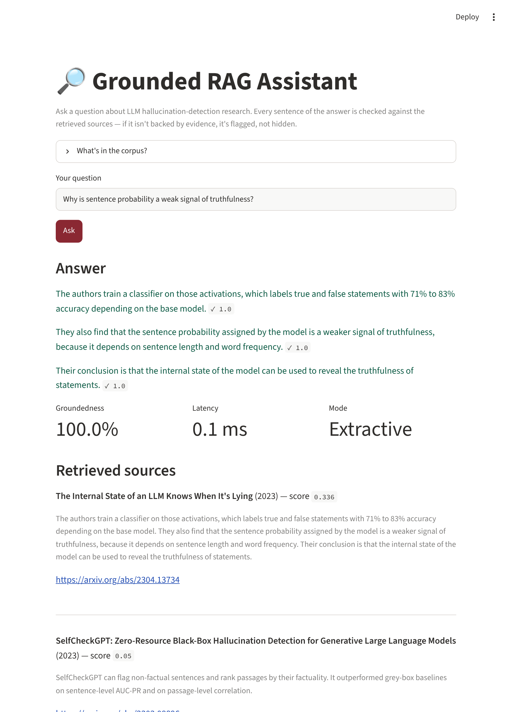

# Grounded RAG Assistant

A small retrieval-augmented question-answering system for LLM hallucination-detection research, with a **deterministic groundedness checker**. A model (or a fallback) writes the answer, and a separate non-LLM step checks every sentence against the retrieved sources and flags what isn't supported.



It runs from a fresh clone with no API key, vector database, GPU or model download. The same idea is applied to LLM outputs in [Automated-LLM-Evaluation-Pipeline](https://github.com/Arpithasp-22/Automated-LLM-Evaluation-Pipeline): measure behaviour instead of trusting a confident tone.

## How it works

```
data/papers.json      8 papers on LLM hallucination detection (metadata + short summaries)
      |
rag/ingest.py         3-sentence chunks, TF-IDF index (scikit-learn, local)
      |
rag/retrieve.py       cosine similarity, top-k, drops chunks below a minimum score
      |
rag/generate.py       OpenAI answer if OPENAI_API_KEY is set, otherwise (or on any error)
      |               an extractive answer built from the retrieved sentences
rag/grounding.py      splits the answer into sentences and checks each against the sources. No LLM.
      |
app.py                Streamlit UI: answer with per-sentence verdicts, metrics, sources
```

### The groundedness check

A sentence is **grounded** when both hold:

1. At least 60% of its content words (stop words removed, lightly stemmed) appear in the best one- or two-sentence window of the retrieved text.
2. Every number in it (such as "71%") also appears in the retrieved text.

Flagged sentences show why, for example `number not in sources: 45`.

## Results

`python -m eval.run_eval` produces these numbers. Everything runs offline on the extractive path.

**Retrieval** (16 answerable questions, top 4):

| Metric | Result |
| --- | --- |
| Expected paper ranked first (hit@1) | 100% |
| Expected paper in top 4 | 100% |
| Off-topic questions correctly rejected | 3 of 4 |
| Retrieve + answer + check time | about 1.4 ms (no LLM) |

**Groundedness checker** on 33 labelled sentences (15 faithful, 18 fabricated), threshold fixed at 0.6 before measuring:

| | Result |
| --- | --- |
| Faithful sentences kept | 93.3% (14 of 15) |
| Fabricated sentences flagged | 77.8% (14 of 18) |
| Fabricated: invented numbers | 5 of 5 flagged |
| Fabricated: off-topic claims | 3 of 3 flagged |
| Fabricated: plausible but unsupported claims | 5 of 5 flagged |
| Fabricated: contradictions that reuse the source's words | **1 of 5 flagged** |

The contradiction row is the important one. Dropping a negation ("needs access to the model's internal probabilities" against a source saying "without access") barely changes the word overlap, so a lexical checker cannot see it. Catching these needs an entailment model; see the roadmap.

Threshold sweep (reported, not used to choose 0.6):

| Threshold | Faithful kept | Fabricated flagged |
| --- | --- | --- |
| 0.4 | 93.3% | 61.1% |
| 0.5 | 93.3% | 72.2% |
| **0.6** | 93.3% | 77.8% |
| 0.7 | 86.7% | 88.9% |
| 0.8 | 80.0% | 88.9% |

## Honest limitations

- **The test sets are small and hand-written by the author**, so treat the numbers as indicative, not a benchmark. The retrieval questions use the corpus's own vocabulary and the corpus has only 8 papers, so 100% hit@1 is an easy result.
- **The corpus is summaries, not full papers.** Each entry is a short summary of the paper's abstract, with the title, authors, year and arXiv link. The papers are real; the text is not their full content.
- **Extractive answers are grounded by construction** (they are copied from the sources), so their 100% groundedness is a sanity check, not a quality result. The checker earns its keep on LLM answers.
- **The LLM path is untested here.** The OpenAI call is covered by unit tests with a stub, but no live API call was run.
- **Retrieval is lexical.** A question that shares a word with the corpus can pass the relevance filter ("boiling point of water at sea level" matched on "level"), and a paraphrased question that shares no words will miss.
- **Grounding is relative to what was retrieved.** A true statement whose supporting chunk was not retrieved is flagged. One of the 15 faithful test sentences fails for this reason.

## Setup

```bash
pip install -r requirements.txt
python -m rag.ingest             # optional: the index is also built automatically on first use
streamlit run app.py
```

For LLM-written answers, copy `.env.example` to `.env` and set `OPENAI_API_KEY`. If the key is missing or the call fails, the app falls back to the extractive answer and says so in the **Mode** box.

```bash
pip install pytest
python -m pytest                 # 16 tests
python -m eval.run_eval          # the results above
```

## Project structure

```
rag/         text helpers, ingest, retrieve, generate, grounding
eval/        golden_qa.json, grounding_cases.json, run_eval.py
data/        papers.json (the corpus); index.pkl is built locally and git-ignored
tests/       16 tests, including the fallback paths and a documented known limit
docs/        app screenshot
app.py       Streamlit UI
```

## Roadmap

- [ ] Add an entailment (NLI) check so contradictions that reuse the source's words are caught
- [ ] Evaluate the LLM path with a real key and report its groundedness
- [ ] Replace TF-IDF with embeddings and compare retrieval on a larger, independently written question set
- [ ] Use full paper text instead of summaries
